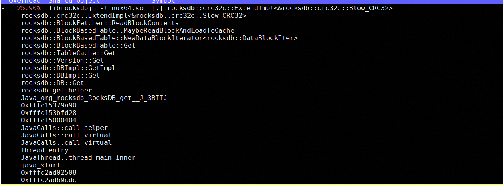
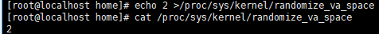

# RocksDB CRC32 Optimization Feature Guide

<!-- md-trans-meta sourceCommit=986a233a9b921ad56b882fc00488a76a858e5ce0 translatedAt=2026-11-06T03:22:00.624Z pushedAt=2026-11-06T06:31:31.254Z nl=2 -->

## Feature Description

### Introduction

This document describes the principles, installation, and usage of the CRC32 optimization feature for RocksDB.

RocksDB is a high-performance, embedded, and persistent key-value storage engine developed by Meta in C++ based on Log-Structured Merge-Tree (LSM-Tree), and is widely used in databases, cache systems, real-time data processing, and other scenarios.

When RocksDB reads SST files, frequent block verifications cause a large number of CRC32 calculations, which has become a significant CPU performance bottleneck, as shown in the following figure. By optimizing the CRC32 algorithm via hardware-based acceleration instructions, the CRC32 hotspot overhead can be reduced, significantly alleviating the CPU load.



### Principles

This feature uses hardware-accelerated CRC32 to reduce the verification overhead, improving the overall performance and system stability of RocksDB on Kunpeng servers.

RocksDB supports multiple CRC32 implementations and can automatically select the optimal implementation based on the operating environment. However, on the Arm platform, the current version does not provide Arm-specific optimization. As a result, the software implementation is used by default, and the performance is significantly lower than that of the hardware-based acceleration solution. In particular, when the CRC32 function is called frequently in the database storage engine kernel, this algorithm becomes a system performance bottleneck, severely limiting the I/O throughput. This feature is based on the new Kunpeng 920 processor model and the Kunpeng 950 processor, and optimizes the CRC32 algorithm using acceleration methods such as assembly code and the pmull instruction. It improves the verification efficiency without changing the service function logic.

**Check method**

Check whether the new Kunpeng 920 processor model supports the CRC32 feature.

```shell
lscpu | grep Flags | grep crc32
```

If `crc32` appears in the output, the condition for enabling this feature is met.

```output
Flags:                              fp asimd evtstrm aes pmull sha1 sha2 crc32 atomics fphp asimdhp cpuid asimdrdm jscvt fcma lrcpc dcpop sha3 sm3 sm4 asimddp sha512 sve asimdfhm dit uscat ilrcpc flagm ssbs sb dcpodp flagm2 frint svei8mm svef32mm svef64mm svebf16 i8mm bf16 dgh rng ecv
```

Check whether the Kunpeng 950 processor supports the CRC32 feature.

```bash
lscpu |grep Flags
```

If `pmull`, `crc32`, `sve2`, and `svepmull` appear in the output, the condition for enabling this feature is met.

```output
Flags: fp asimd evtstrm aes pmull sha1 sha2 crc32 atomics fphp asimdhp cpuid asimdrdm jscvt fcma lrcpc dcpop sha3 sm3 sm4 asimddp sha512 sve asimdfhm dit uscat ilrcpc flagm ssbs sb dcpodp sve2 sveaes svepmull svebitperm svesha3 svesm4 flagm2 frint svei8mm svebf16 i8mm bf16 dgh rng ecv afp rpres wfxt rprfm hbc ls64 ls64_v
```

## Environment Requirements

This document provides guidance based on specific environments. Before performing operations, ensure that your hardware and software meet the requirements.

**Table 1** Hardware requirement

| Item | Description                                                |
| ---- | --------------------------------------------------- |
| CPU  | New Kunpeng 920 processor model or Kunpeng 950 processor |

**Table 2** OS and software requirements<a id="os-and-software-requirements"></a>

| Item | Version | How to Obtain |
| --- | --- | --- |
| OS | openEuler 24.03 LTS SP3 | [openEuler-24.03-LTS-SP3-everything-aarch64-dvd.iso](https://repo.huaweicloud.com/openeuler/openEuler-24.03-LTS-SP3/ISO/aarch64/openEuler-24.03-LTS-SP3-everything-aarch64-dvd.iso) |
| OS | openEuler 22.03 LTS SP4 | [openEuler-22.03-LTS-SP4-everything-aarch64-dvd.iso](https://repo.huaweicloud.com/openeuler/openEuler-22.03-LTS-SP4/ISO/aarch64/openEuler-22.03-LTS-SP4-everything-aarch64-dvd.iso) |
| RocksDB | 6.1.2 | [rocksdb repository (v6.1.2 branch)](https://github.com/facebook/rocksdb/tree/v6.1.2) |
| RocksDB | 6.26.1 | [rocksdb repository (v6.26.1 branch)](https://github.com/facebook/rocksdb/tree/v6.26.1) |
| GCC | 10.3.1 | Provided with openEuler 22.03 LTS SP4. |
| GCC | 12.3.1 (24.03 LTS SP3) | Install it using Yum. |
| GCC | 12.3.1 (22.03 LTS SP4) | [gcc-12.3.1-2025.06-aarch64-linux.tar.gz](https://mirrors.huaweicloud.com/kunpeng/archive/compiler/kunpeng_gcc/gcc-12.3.1-2025.06-aarch64-linux.tar.gz) |
| Java | 1.8.0 | Install it using Yum on openEuler 22.03 LTS SP4 when the network connection is normal. |
| Java | 11 | Install it using Yum. |
| CRC32 optimization patch (for RocksDB 6.1.2) | `0001-crc32c-sve2-arm64-combined.patch` | [rocksdb-v6.1.2-patch](https://gitcode.com/boostkit/rocksdb/blob/rocksdb-v6.1.2-patch/0001-crc32c-sve2-arm64-combined.patch) |
| CRC32 optimization patch (for RocksDB 6.26.1) | `0002_crc32c_opt.patch` | [0002_crc32c_opt.patch](https://gitcode.com/boostkit/rocksdb/tree/master/src/rocksdb-6.26.1/feature-patches/0002_crc32c_opt.patch) |

## Installation Environment

### For RocksDB 6.1.2

The RocksDB CRC32 optimization feature is developed for RocksDB 6.1.2 and is provided as a patch file. To install and use this feature, apply the patch file to the RocksDB source code and then compile RocksDB.

1. Use `git` to clone RocksDB, switch to version 6.1.2, and place it in the home directory `~`.

    ```shell
    cd ~
    git clone https://github.com/facebook/rocksdb.git
    cd rocksdb/
    git checkout v6.1.2
    ```

2. Install dependencies using Yum and configure environment variables.

    ```shell
    yum install -y git make gcc-c++ snappy snappy-devel zlib zlib-devel bzip2 bzip2-devel lz4 lz4-devel zstd zstd-devel java java-devel java-11-openjdk-devel gflags gflags-devel flex python maven
    
    export JAVA_HOME=/usr/lib/jvm/java-1.8.0
    export PATH=$JAVA_HOME/bin:$PATH
    ```

3. Obtain the patch file of the optimization feature and upload it to the home directory `~`.

    For details about how to obtain the patch, see [**Table 2**](#os-and-software-requirements).

4. Apply the optimization feature patch. If no command output is displayed, the patch is successfully applied.

    ```shell
    cd ~/rocksdb
    git apply --whitespace=nowarn < ~/0001-crc32c-sve2-arm64-combined.patch
    ```

5. Compile the RocksDB JAR packages and related dynamic libraries to use the optimization feature.
    1. Fix the bug in the source code when the JAR packages and related dynamic libraries are compiled.
        1. Access the path to the source code to be modified.

            ```shell
            cd ~/rocksdb
            ```

        2. Open the `BlockBasedTableConfig.java` file.

            ```shell
            vim java/src/main/java/org/rocksdb/BlockBasedTableConfig.java
            ```

        3. Press `i` to enter the insert mode and change `true` to `false` on line 38.

            ```txt
            # Change true to false on line 38.
            verifyCompression = false;
            ```

        4. Press `Esc`, type `:wq!`, and press `Enter` to save the file and exit.

    2. Compile the JAR packages and related dynamic libraries of RocksDB.

        ```txt
        PORTABLE=1 DEBUG_LEVEL=0 make rocksdbjava -j`nproc` DISABLE_WARNING_AS_ERROR=1 DISABLE_JEMALLOC=1
        ```

    3. (Optional) If an error is reported during the compilation, indicating that JAR packages are missing, clear the files, manually download the missing JAR packages, and then perform compilation again.

        ```shell
        cd ~/rocksdb
        make clean
        mkdir -p java/test-libs
        cd java/test-libs
        wget https://repo1.maven.org/maven2/org/assertj/assertj-core/1.7.1/assertj-core-1.7.1.jar --no-check-certificate
        wget https://repo1.maven.org/maven2/cglib/cglib/2.2.2/cglib-2.2.2.jar --no-check-certificate 
        wget https://repo1.maven.org/maven2/org/mockito/mockito-all/1.10.19/mockito-all-1.10.19.jar --no-check-certificate
        wget https://repo1.maven.org/maven2/org/hamcrest/hamcrest-core/1.3/hamcrest-core-1.3.jar --no-check-certificate
        wget https://repo1.maven.org/maven2/junit/junit/4.12/junit-4.12.jar --no-check-certificate
        ```

### For RocksDB 6.26.1

To install and use this feature, you must first apply the patch file to the RocksDB source code, and then compile RocksDB.

1. Use Git to clone RocksDB, switch to version 6.26.1, and place it in the home directory `~`.

   ```bash
   cd ~
   git clone https://github.com/facebook/rocksdb.git
   cd rocksdb/
   git checkout v6.26.1
   ```

2. Download and install GCC 12.3.1.

   ```bash
   cd ~
   wget https://mirrors.huaweicloud.com/kunpeng/archive/compiler/kunpeng_gcc/gcc-12.3.1-2025.06-aarch64-linux.tar.gz
   tar -zxvf gcc-12.3.1-2025.06-aarch64-linux.tar.gz
   
   export PATH=~/gcc-12.3.1-2025.06-aarch64-linux/bin:$PATH
   export LD_LIBRARY_PATH=~/gcc-12.3.1-2025.06-aarch64-linux/lib64:$LD_LIBRARY_PATH
   export INCLUDE=~/gcc-12.3.1-2025.06-aarch64-linux/include:$INCLUDE
   ```

3. Install dependencies using Yum and configure environment variables.

   ```bash
   yum install -y git make snappy snappy-devel zlib zlib-devel bzip2 bzip2-devel lz4 lz4-devel zstd zstd-devel java java-devel java-11-openjdk-devel gflags gflags-devel flex python maven
   
   export JAVA_HOME=/usr/lib/jvm/java-11
   export PATH=$JAVA_HOME/bin:$PATH
   ```

4. Obtain the patch file of the optimization feature and upload it to the home directory `~`.

   For details about how to obtain it, see [**Table 2**](#os-and-software-requirements).

5. Run the following commands to apply the optimization feature. If no output is displayed, the patch is successfully applied.

   ```bash
   cd ~/rocksdb
   git apply --whitespace=nowarn ~/0002_crc32c_opt.patch
   ```

6. Compile the RocksDB JAR packages and related dynamic libraries to use the optimization feature.

   1. Compile the JAR packages and related dynamic libraries of RocksDB.

      ```bash
      make clean
      PORTABLE=1 DEBUG_LEVEL=0 make rocksdbjava -j`nproc` DISABLE_WARNING_AS_ERROR=1 DISABLE_JEMALLOC=1
      ```

   2. (Optional) If an error is reported during the compilation, indicating that JAR packages are missing, clear the files, manually download the missing JAR packages, and then perform compilation again.
   
      ```bash
      cd ~/rocksdb
      make clean
      mkdir -p java/test-libs
      cd java/test-libs
      wget https://repo1.maven.org/maven2/org/assertj/assertj-core/2.9.0/assertj-core-2.9.0.jar --no-check-certificate
      wget https://repo1.maven.org/maven2/cglib/cglib/3.3.0/cglib-3.3.0.jar --no-check-certificate 
      wget https://repo1.maven.org/maven2/org/mockito/mockito-all/1.10.19/mockito-all-1.10.19.jar --no-check-certificate
      wget https://repo1.maven.org/maven2/org/hamcrest/hamcrest-core/2.2/hamcrest-core-2.2.jar --no-check-certificate
      wget https://repo1.maven.org/maven2/junit/junit/4.13.1/junit-4.13.1.jar --no-check-certificate
      ```
   
   3. Replace the JAR package in the local Maven repository.
      
      ```bash
      cd ~/rocksdb
      cp java/target/rocksdbjni-6.26.1-linux64.jar \
         ~/.m2/repository/org/rocksdb/rocksdbjni/6.26.1/rocksdbjni-6.26.1.jar
      cp java/target/rocksdbjni-6.26.1-linux64.jar.sha1 \
         ~/.m2/repository/org/rocksdb/rocksdbjni/6.26.1/rocksdbjni-6.26.1.jar.sha1
      ```
      
   4. Extract the native dynamic library and set `LD_LIBRARY_PATH`.
      
      ```bash
      # Create the library storage directory (for YCSB use).
      mkdir -p ~/Test/rocksdb-lib
      # Clear old files.
      rm -f ~/Test/rocksdb-lib/*
      # Decompress the .so file.
      unzip -jo ~/.m2/repository/org/rocksdb/rocksdbjni/6.26.1/rocksdbjni-6.26.1.jar "*.so" -d ~/Test/rocksdb-lib
      # Verify the .so file.
      ls -lh ~/Test/rocksdb-lib/
      # Set the environment variable.
      export LD_LIBRARY_PATH=~/Test/rocksdb-lib:$LD_LIBRARY_PATH
      ```

## Performance Benefits

You can use the YCSB tool to compare the performance before and after enabling this feature. For detailed test steps, see [YCSB Test Guide](https://www.hikunpeng.com/document/detail/en/kunpengdbs/testguide/tstg/kunpengycsbformong_11_0001.html). The RocksDB CRC32 optimization feature can improve the performance of workloada and workloadc by 5% to 10% on average with a 16-vCPU configuration.

## Security Check and Hardening

Address space layout randomization (ASLR) is a security technology against buffer overflow. It randomizes the layout of linear areas such as heap, stack, and shared library mapping to make it difficult for attackers to predict target addresses and directly locate code, thereby preventing overflow attacks.

```bash
echo 2 | sudo tee /proc/sys/kernel/randomize_va_space
cat /proc/sys/kernel/randomize_va_space
```



## Change History

|Version| Date   | Description         |
|----------| ---------- | ---------------- |
|01| 2026-09-30 | This is the first official release. |
