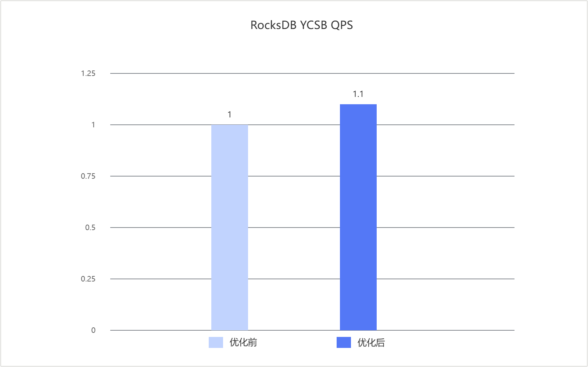

# RocksDB 6.26.1 GCC编译优化 特性指南

## 特性描述

### 简介

本文介绍RocksDB数据库通过构建脚本参数启用GCC编译优化特性的方法、环境要求及验证流程。
RocksDB作为嵌入式键值存储引擎，其执行热点会随上层业务的读写比例、数据访问分布和请求类型而变化。单纯依赖静态编译难以准确反映这些差异，需要根据具有代表性的业务负载采集运行信息，使编译器围绕实际热点优化代码生成。GCC编译优化特性通过编译器选项改变目标文件和最终产物的优化级别或架构指令。

### 原理描述

RocksDB数据库通过GCC PGO进行编译优化。业务测试过程中采集RocksDB的函数执行频次和分支信息，再使用生成的Profile（性能分析数据）后重新构建RocksDB。GCC据此识别当前负载下的热点路径，并调整函数内联、分支预测、代码布局和循环优化等编译决策。
RocksDB的编译流程包括“插桩构建、负载测试、反馈构建”三个阶段。首先使用`-fprofile-generate`构建带插桩的RocksDB，再执行业务测试，将函数执行频次、分支走向等信息写入指定profile目录。测试负载的读写比例、数据规模和访问分布用于模拟目标业务访问模式，生成的Profile能够反映该负载下的函数热点和分支行为。
使用`-fprofile-use`选项，将生成的Profile重新构建RocksDB优化版本。

## 已验证环境

本文基于特定环境提供指导，在正式操作前请确保软硬件均满足要求。

**表1** 硬件要求

| 项目 | 规格 |
| ---- | ---- |
| CPU | 鲲鹏950处理器 |

**表2** 操作系统和软件要求<a id="操作系统和软件要求"></a>

| 项目 | 版本 | 获取地址 |
| --- | --- | --- |
| 操作系统 | openEuler 24.03 LTS SP3 | [获取链接](https://repo.huaweicloud.com/openeuler/openEuler-24.03-LTS-SP3/ISO/aarch64/openEuler-24.03-LTS-SP3-everything-aarch64-dvd.iso) |
| 操作系统 | openEuler 22.03 LTS SP4 | [获取链接](https://repo.huaweicloud.com/openeuler/openEuler-22.03-LTS-SP4/ISO/aarch64/openEuler-22.03-LTS-SP4-everything-aarch64-dvd.iso) |
| RocksDB | 6.26.1 | [获取链接](https://github.com/facebook/rocksdb/tree/v6.26.1) |
| GCC | 12.3.1（24.03 LTS SP3） | 通过yum源安装 |
| GCC | 12.3.1（22.03 LTS SP4） | [获取链接](https://mirrors.huaweicloud.com/kunpeng/archive/compiler/kunpeng_gcc/gcc-12.3.1-2025.06-aarch64-linux.tar.gz) |
| Java | 11 | 通过yum源安装 |
| GCC编译优化patch | 0001-0005相关补丁 | [获取链接](https://gitcode.com/boostkit/rocksdb/tree/master/src/rocksdb-6.26.1/feature-patches) |

## 安装和使用特性

1. 使用git克隆RocksDB并切换到6.26.1版本，放在$HOME目录下。

   ```bash
   cd $HOME
   git clone https://github.com/facebook/rocksdb.git
   cd rocksdb/
   git checkout v6.26.1
   ```

2. 下载并安装GCC 12.3.1编译器。

   ```bash
   cd ~
   wget https://mirrors.huaweicloud.com/kunpeng/archive/compiler/kunpeng_gcc/gcc-12.3.1-2025.06-aarch64-linux.tar.gz
   tar -zxvf gcc-12.3.1-2025.06-aarch64-linux.tar.gz

   export PATH=~/gcc-12.3.1-2025.06-aarch64-linux/bin:$PATH
   export LD_LIBRARY_PATH=~/gcc-12.3.1-2025.06-aarch64-linux/lib64:$LD_LIBRARY_PATH
   export INCLUDE=~/gcc-12.3.1-2025.06-aarch64-linux/include:$INCLUDE
   ```

3. 安装yum依赖和配置环境变量。

   ```bash
   yum install -y git make snappy snappy-devel zlib zlib-devel bzip2 bzip2-devel lz4 lz4-devel zstd zstd-devel java java-devel java-11-openjdk-devel gflags gflags-devel flex python maven

   export JAVA_HOME=/usr/lib/jvm/java-11
   export PATH=$JAVA_HOME/bin:$PATH
   ```

4. （可选）获取优化特性的补丁文件，将其上传到$HOME目录下。

   获取路径请参见[表2操作系统和软件要求](#操作系统和软件要求)。

5. （可选）进入`$HOME/rocksdb`目录，按照feature-patches目录中的实际文件名依次应用0001-0005相关补丁。如果没有输出则说明合入成功。

6. RocksDB使能GCC编译优化特性。

   1. 插桩重新编译RocksDB。

      ```bash
      #!/bin/bash
      WORKSPACE=$HOME
      OPT_FLAGS="-O3 -flto -fprofile-generate=$WORKSPACE/pgo -fno-plt -fprofile-update=single -fprofile-partial-training -Wno-error=coverage-mismatch -Wno-error=missing-profile -fprofile-correction"

      export JAVA_HOME=/usr/lib/jvm/java-11
      export PATH=$JAVA_HOME/bin:$PATH
      cd $WORKSPACE/rocksdb
      export EXTRA_CFLAGS=${OPT_FLAGS}
      export EXTRA_CXXFLAGS=${OPT_FLAGS}
      export EXTRA_LDFLAGS=${OPT_FLAGS}
      export OPTIMIZE_LEVEL="-O3"

      make clean
      PORTABLE=1 DEBUG_LEVEL=0 make rocksdbjava -j$nproc DISABLE_WARNING_AS_ERROR=1 DISABLE_JEMALLOC=1
      ```

   2. 运行压测进行采样。

      以YCSB压测为例，参考[鲲鹏YCSB测试指南](https://www.hikunpeng.com/document/detail/zh/kunpengdbs/testguide/tstg/kunpengycsbformong_11_0001.html)。

   3. 重新编译优化版本RocksDB。

      将插桩编译脚本中的`-fprofile-generate`替换为`-fprofile-use`，根据热点数据重新编译优化版本。

      ```bash
      #!/bin/bash
      WORKSPACE=$HOME
      OPT_FLAGS="-O3 -flto -fprofile-use=$WORKSPACE/pgo -fno-plt -fprofile-update=single -fprofile-partial-training -Wno-error=coverage-mismatch -Wno-error=missing-profile -fprofile-correction"

      export JAVA_HOME=/usr/lib/jvm/java-11
      export PATH=$JAVA_HOME/bin:$PATH
      cd $WORKSPACE/rocksdb
      export EXTRA_CFLAGS=${OPT_FLAGS}
      export EXTRA_CXXFLAGS=${OPT_FLAGS}
      export EXTRA_LDFLAGS=${OPT_FLAGS}
      export OPTIMIZE_LEVEL="-O3"

      make clean
      PORTABLE=1 DEBUG_LEVEL=0 make rocksdbjava -j$nproc DISABLE_WARNING_AS_ERROR=1 DISABLE_JEMALLOC=1
      ```

7. 执行测试，验证GCC编译优化特性是否生效。

   以YCSB压测为例，参考[鲲鹏YCSB测试指南](https://www.hikunpeng.com/document/detail/zh/kunpengdbs/testguide/tstg/kunpengycsbformong_11_0001.html)。

   测试中每个RocksDB实例绑定8核、起16线程，使用包含1亿条数据的数据集、value大小为256B，以5个YCSB客户端线程依次执行YCSB Workload A-F。叠加使用GCC编译优化特性和内存分配优化特性后，性能平均提升10%，优化前后对比效果如[双特性叠加使能前后性能对比](#双特性叠加使能前后性能对比)所示。

   **图1** 双特性叠加使能前后性能对比<a id="双特性叠加使能前后性能对比"></a>

   

## 安全检查与加固

ASLR（Address Space Layout Randomization，地址空间布局随机化）是一种针对缓冲区溢出的安全保护技术，通过对堆、栈、共享库映射等线性区布局的随机化，增加攻击者预测目的地址的难度，防止攻击者直接定位攻击代码位置，达到阻止溢出攻击的目的。

```bash
echo 2 > /proc/sys/kernel/randomize_va_space
cat /proc/sys/kernel/randomize_va_space
```


## 修订记录

|文档版本| 发布日期   | 修改说明         |
|----------| ---------- | ---------------- |
|01| 2026-09-30 | 第一次正式发布。 |
