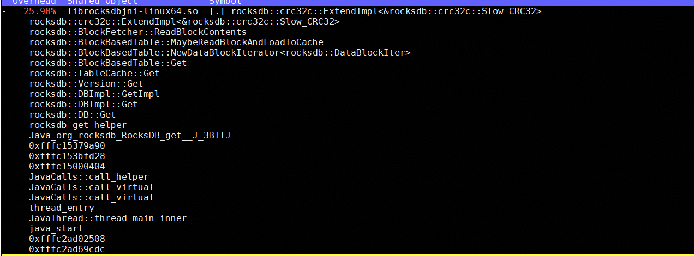
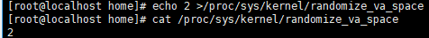

# RocksDB CRC32优化 特性指南

## 特性描述

### 简介

本文主要介绍RocksDB数据库CRC32C优化特性的优化原理和安装使用方法。

RocksDB是Meta开发的基于C++和LSM-Tree的高性能嵌入式持久化键值存储引擎，广泛运用于数据库、缓存系统及实时数据处理等场景。

在RocksDB的SST文件读取过程中，频繁的块校验操作导致了大量的CRC32计算，这一过程已成为明显的CPU性能瓶颈，如下图所示。通过优化CRC32算法使用基于硬件的加速指令，可以有效消减CRC32热点开销，显著缓解CPU压力。



### 原理描述

本特性通过硬件加速CRC32减少校验开销，提升RocksDB在鲲鹏服务器中的整体性能表现与系统稳定性。

RocksDB支持多种CRC32实现，能够根据运行环境自动选择最优方案。然而，在ARM平台下，当前版本尚未针对其架构提供专用优化，导致默认采用软件实现，性能显著低于硬件加速方案。尤其在内核态中CRC32函数调用频繁时，该算法已成为系统性能瓶颈，严重影响I/O吞吐。本特性基于鲲鹏920新型号处理器和鲲鹏950处理器，使用汇编、pmull指令等加速方式优化CRC32算法，来提升校验效率，业务功能逻辑无变化。

**查看方式**

检查当前CPU是否支持CRC32：

```shell
lscpu | grep Flags | grep crc32
```

回显结果中包含crc32，表示CPU支持CRC32硬件指令。

```txt
Flags:                              fp asimd evtstrm aes pmull sha1 sha2 crc32 atomics fphp asimdhp cpuid asimdrdm jscvt fcma lrcpc dcpop sha3 sm3 sm4 asimddp sha512 sve asimdfhm dit uscat ilrcpc flagm ssbs sb dcpodp flagm2 frint svei8mm svef32mm svef64mm svebf16 i8mm bf16 dgh rng ecv
```

## 环境要求

本文基于特定环境提供指导，在正式操作前请确保软硬件均满足要求。

**表1** 硬件要求

| 项目 | 说明                                                |
| ---- | --------------------------------------------------- |
| CPU  | 鲲鹏920新型号处理器、鲲鹏950处理器 |

**表2** 操作系统和软件要求<a id="操作系统和软件要求"></a>

| 项目 | 版本 | 获取地址 |
| --- | --- | --- |
| 操作系统 | openEuler 24.03 LTS SP3 | [下载openEuler-24.03-LTS-SP3-everything-aarch64-dvd.iso](https://repo.huaweicloud.com/openeuler/openEuler-24.03-LTS-SP3/ISO/aarch64/openEuler-24.03-LTS-SP3-everything-aarch64-dvd.iso) |
| 操作系统 | openEuler 22.03 LTS SP4 | [下载openEuler-22.03-LTS-SP4-everything-aarch64-dvd.iso](https://repo.huaweicloud.com/openeuler/openEuler-22.03-LTS-SP4/ISO/aarch64/openEuler-22.03-LTS-SP4-everything-aarch64-dvd.iso) |
|RocksDB|6.1.2|[rocksdb仓库（v6.1.2分支）](https://github.com/facebook/rocksdb/tree/v6.1.2)|
| RocksDB | 6.26.1 | [rocksdb仓库（v6.26.1分支）](https://github.com/facebook/rocksdb/tree/v6.26.1) |
|GCC|10.3.1|openEuler 22.03 LTS SP4版本自带|
| GCC | 12.3.1（24.03 LTS SP3） | 通过yum源安装 |
| GCC | 12.3.1（22.03 LTS SP4） | [下载gcc-12.3.1-2025.06-aarch64-linux.tar.gz](https://mirrors.huaweicloud.com/kunpeng/archive/compiler/kunpeng_gcc/gcc-12.3.1-2025.06-aarch64-linux.tar.gz) |
|Java|1.8.0|在openEuler 22.03 LTS SP4系统上，确保网络畅通情况下，利用Yum工具直接安装|
| Java | 11 | 通过yum源安装 |
| CRC32C优化patch（适用RocksDB 6.1.2）|0001-crc32c-sve2-arm64-combined.patch|[获取rocksdb-v6.1.2-patch](https://gitcode.com/boostkit/rocksdb/blob/rocksdb-v6.1.2-patch/0001-crc32c-sve2-arm64-combined.patch)|
| CRC32C优化patch（适用RocksDB 6.26.1） | 0002_crc32c_opt.patch | [获取0002_crc32c_opt.patch](https://gitcode.com/boostkit/rocksdb/tree/master/src/rocksdb-6.26.1/feature-patches/0002_crc32c_opt.patch) |

## 安装环境

### For RocksDB 6.1.2

RocksDB CRC32优化特性针对RocksDB 6.1.2版本进行开发，以patch文件形式提供。安装和使用该特性需先在RocksDB源码中应用该patch文件，再编译RocksDB。

1. 使用git克隆RocksDB并切换到6.1.2版本，放在主目录“\~”下。

    ```shell
    cd ~
    git clone https://github.com/facebook/rocksdb.git
    cd rocksdb/
    git checkout v6.1.2
    ```

2. 安装yum依赖和环境变量配置。

    ```shell
    yum install -y git make gcc-c++ snappy snappy-devel zlib zlib-devel bzip2 bzip2-devel lz4 lz4-devel zstd zstd-devel java java-devel java-11-openjdk-devel gflags gflags-devel flex python maven
    
    export JAVA_HOME=/usr/lib/jvm/java-1.8.0
    export PATH=$JAVA_HOME/bin:$PATH
    ```

3. 获取优化特性的补丁文件，将其上传到主目录“\~”下。

    获取路径请参见[**表 2** 操作系统和软件要求](#操作系统和软件要求)。

4. 执行以下命令，合入优化特性。没有输出则说明合入成功。

    ```shell
    cd ~/rocksdb
    git apply --whitespace=nowarn < ~/0001-crc32c-sve2-arm64-combined.patch
    ```

5. 编译RocksDB的jar包和相关动态库，以使用优化特性。
    1. 修改原生代码在编译jar包和相关动态库时的bug。
        1. 进入修改原生代码路径。

            ```shell
            cd ~/rocksdb
            ```

        2. 打开BlockBasedTableConfig.java文件。

            ```shell
            vim java/src/main/java/org/rocksdb/BlockBasedTableConfig.java
            ```

        3. 按“i”进入编辑模式，修改第38行，将true改为false。

            ```txt
            # 修改第38行，true改为false
            verifyCompression = false;
            ```

        4. 按“Esc”键，输入 **:wq!**，按“Enter”保存并退出编辑。

    2. 编译RocksDB的jar包和相关动态库。

        ```txt
        PORTABLE=1 DEBUG_LEVEL=0 make rocksdbjava -j`nproc` DISABLE_WARNING_AS_ERROR=1 DISABLE_JEMALLOC=1
        ```

    3. （可选）若是编译过程中报缺少jar包的错误，可以先清理文件，再手动下载缺少的jar包，然后重新进行编译。

        ```shell
        cd ~/rocksdb
        make clean
        mkdir -p java/test-libs
        cd java/test-libs
        wget https://repo1.maven.org/maven2/org/assertj/assertj-core/1.7.1/assertj-core-1.7.1.jar --no-check-certificate
        wget https://repo1.maven.org/maven2/cglib/cglib/2.2.2/cglib-2.2.2.jar --no-check-certificate 
        wget https://repo1.maven.org/maven2/org/mockito/mockito-all/1.10.19/mockito-all-1.10.19.jar --no-check-certificate
        wget https://repo1.maven.org/maven2/org/hamcrest/hamcrest-core/1.3/hamcrest-core-1.3.jar --no-check-certificate
        wget https://repo1.maven.org/maven2/junit/junit/4.12/junit-4.12.jar --no-check-certificate
        ```

### For RocksDB 6.26.1

安装和使用该特性需先在RocksDB源码中应用该patch文件，再编译RocksDB。

1. 使用git克隆RocksDB并切换到6.26.1版本，放在主目录“\~”下。

   ```bash
   cd ~
   git clone https://github.com/facebook/rocksdb.git
   cd rocksdb/
   git checkout v6.26.1
   ```

2. 下载并安装GCC 12.3.1编译器。

   ```bash
   cd ~
   wget https://mirrors.huaweicloud.com/kunpeng/archive/compiler/kunpeng_gcc/gcc-12.3.1-2025.06-aarch64-linux.tar.gz
   tar -zxvf gcc-12.3.1-2025.06-aarch64-linux.tar.gz
   
   export PATH=~/gcc-12.3.1-2025.06-aarch64-linux/bin:$PATH
   export LD_LIBRARY_PATH=~/gcc-12.3.1-2025.06-aarch64-linux/lib64:$LD_LIBRARY_PATH
   export INCLUDE=~/gcc-12.3.1-2025.06-aarch64-linux/include:$INCLUDE
   ```

3. 安装yum依赖和环境变量配置。

   ```bash
   yum install -y git make snappy snappy-devel zlib zlib-devel bzip2 bzip2-devel lz4 lz4-devel zstd zstd-devel java java-devel java-11-openjdk-devel gflags gflags-devel flex python maven
   
   export JAVA_HOME=/usr/lib/jvm/java-11
   export PATH=$JAVA_HOME/bin:$PATH
   ```

4. 获取优化特性的补丁文件，将其上传到主目录"~"下。

   获取路径请参见[**表2** 操作系统和软件要求](#操作系统和软件要求)。

5. 执行以下命令，合入优化特性。如果没有输出则说明合入成功。

   ```bash
   cd ~/rocksdb
   git apply --whitespace=nowarn ~/0002_crc32c_opt.patch
   ```

6. 编译RocksDB的jar包和相关动态库，以使用优化特性。

   1. 编译RocksDB的jar包和相关动态库。

      ```bash
      make clean
      PORTABLE=1 DEBUG_LEVEL=0 make rocksdbjava -j`nproc` DISABLE_WARNING_AS_ERROR=1 DISABLE_JEMALLOC=1
      ```

   2. （可选）若是编译过程中报缺少jar包的错误，可以先清理文件，再手动下载缺少的jar包，然后重新进行编译。
   
      ```bash
      cd ~/rocksdb
      make clean
      mkdir -p java/test-libs
      cd java/test-libs
      wget https://repo1.maven.org/maven2/org/assertj/assertj-core/2.9.0/assertj-core-2.9.0.jar --no-check-certificate
      wget https://repo1.maven.org/maven2/cglib/cglib/3.3.0/cglib-3.3.0.jar --no-check-certificate 
      wget https://repo1.maven.org/maven2/org/mockito/mockito-all/1.10.19/mockito-all-1.10.19.jar --no-check-certificate
      wget https://repo1.maven.org/maven2/org/hamcrest/hamcrest-core/2.2/hamcrest-core-2.2.jar --no-check-certificate
      wget https://repo1.maven.org/maven2/junit/junit/4.13.1/junit-4.13.1.jar --no-check-certificate
      ```
   
   3. 替换本地Maven仓库中的jar包。
      
      ```bash
      cd ~/rocksdb
      cp java/target/rocksdbjni-6.26.1-linux64.jar \
         ~/.m2/repository/org/rocksdb/rocksdbjni/6.26.1/rocksdbjni-6.26.1.jar
      cp java/target/rocksdbjni-6.26.1-linux64.jar.sha1 \
         ~/.m2/repository/org/rocksdb/rocksdbjni/6.26.1/rocksdbjni-6.26.1.jar.sha1
      ```
      
   4. 提取原生动态库并设置`LD_LIBRARY_PATH`。
      
      ```bash
      # 创建库存放目录（供 YCSB 使用）
      mkdir -p ~/Test/rocksdb-lib
      # 清空旧文件
      rm -f ~/Test/rocksdb-lib/*
      # 解压.so文件
      unzip -jo ~/.m2/repository/org/rocksdb/rocksdbjni/6.26.1/rocksdbjni-6.26.1.jar "*.so" -d ~/Test/rocksdb-lib
      # 验证
      ls -lh ~/Test/rocksdb-lib/
      # 设置环境变量
      export LD_LIBRARY_PATH=~/Test/rocksdb-lib:$LD_LIBRARY_PATH
      ```

## 性能收益

通过YCSB工具测试可以得到使能本特性前后的性能提升效果，详细测试步骤请参见《[YCSB测试指导](https://www.hikunpeng.com/document/detail/zh/kunpengdbs/testguide/tstg/kunpengycsbformong_11_0001.html)》。
使用RocksDB CRC32优化特性可以使16U规格下两个用例workloada和workloadc的性能平均提升5%~10%。

## 安全检查与加固

ASLR（Address Space Layout Randomization，地址空间布局随机化）是一种针对缓冲区溢出的安全保护技术，通过对堆、栈、共享库映射等线性区布局的随机化，增加攻击者预测目的地址的难度，防止攻击者直接定位攻击代码位置，达到阻止溢出攻击的目的。

```bash
echo 2 | sudo tee /proc/sys/kernel/randomize_va_space
cat /proc/sys/kernel/randomize_va_space
```



## 修订记录

|文档版本| 发布日期   | 修改说明         |
|----------| ---------- | ---------------- |
|01| 2026-09-30 | 第一次正式发布。 |
